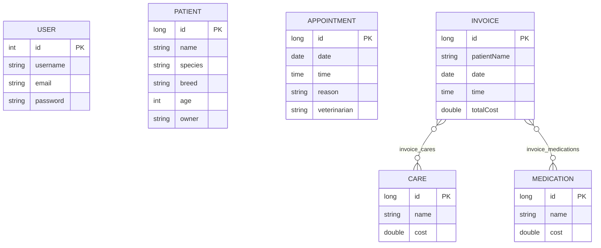

# Semana2-CDY2203

API REST para la gestión de una veterinaria. Está implementada con Spring Boot
3.4.4, Java 17, Spring Web, Spring Data JPA, Spring Security, MySQL, JJWT e
iText.

## Ejecución

La aplicación escucha en el puerto `8180` y utiliza MySQL. La configuración
actual está en `src/main/resources/application.properties`:

- Base de datos: `mydatabase`
- URL configurada: `jdbc:mysql://mysql-cdy2203:3306/mydatabase`
- Usuario configurado: `myuser`
- DDL de Hibernate: `spring.jpa.hibernate.ddl-auto=update`

Para ejecutar la aplicación:

```bash
./mvnw spring-boot:run
```

Para ejecutar las pruebas:

```bash
./mvnw test
```

## Entidades y relaciones

Las entidades JPA del proyecto son:

| Entidad | Campos principales | Relación |
| --- | --- | --- |
| `User` | `id`, `username`, `email`, `password` | No tiene una relación JPA con las demás entidades. |
| `Patient` | `id`, `name`, `species`, `breed`, `age`, `owner` | No tiene una relación JPA con las demás entidades. |
| `Appointment` | `id`, `date`, `time`, `reason`, `veterinarian` | No tiene una relación JPA con `Patient` ni con `User`. |
| `Care` | `id`, `name`, `cost` | Puede pertenecer a muchas facturas. |
| `Medication` | `id`, `name`, `cost` | Puede pertenecer a muchas facturas. |
| `Invoice` | `id`, `patientName`, `date`, `time`, `totalCost` | Tiene relaciones `@ManyToMany` con `Care` y `Medication`. |

`Invoice` mantiene las siguientes tablas intermedias:

- `invoice_cares(invoice_id, care_id)`
- `invoice_medications(invoice_id, medication_id)`

Al guardar una factura, `InvoiceService` verifica que todos los `Care` y
`Medication` recibidos existan. El total se calcula sumando sus costos y se
guarda en `totalCost`; no se acepta el total calculado por el cliente como
fuente de verdad.

### Diagrama de entidades



El diagrama representa únicamente las relaciones declaradas en JPA. Aunque
`Invoice` almacena `patientName`, no existe una asociación JPA o una clave
foránea hacia `Patient`; `Appointment` tampoco está asociado a un paciente.

## Roles y reglas de acceso por ruta

La configuración se encuentra en `WebSecurityConfig`.

| Ruta/método | Acceso |
| --- | --- |
| `POST /login` | Público (`permitAll`). |
| `GET /login` | Público en la configuración, aunque `LoginController` solo implementa `POST`. |
| Cualquier otra ruta y método | Requiere un JWT válido (`authenticated`). |

El token generado contiene la autoridad `ROLE_USER`. Sin embargo, actualmente
no hay reglas `hasRole(...)`, `hasAuthority(...)` ni permisos diferenciados por
ruta: cualquier usuario autenticado con un token válido puede acceder a los
endpoints protegidos. El proyecto tampoco define rutas públicas específicas
para `patient`, `appointment`, `care`, `medication`, `invoice` o `greetings`.

Endpoints disponibles:

| Recurso | Operaciones |
| --- | --- |
| `/patient` | `GET /patient/register`, `GET /patient`, `GET /patient/{id}`, `POST /patient`, `DELETE /patient/{id}` |
| `/appointment` | `GET`, `GET /{id}`, `POST`, `DELETE /{id}` |
| `/care` | `GET`, `GET /{id}`, `POST`, `DELETE /{id}` |
| `/medication` | `GET`, `GET /{id}`, `POST`, `DELETE /{id}` |
| `/invoice` | `GET`, `GET /{id}`, `POST`, `DELETE /{id}`, `GET /pdf/{id}` |
| `/greetings` | `GET` mediante `SecuredController` |

## Flujo exacto del JWT

1. El cliente envía `POST /login` con un `User` JSON que contiene `username` y
   `password`.
2. `LoginController` llama a
   `MyUserDetailsService.loadUserByUsername(username)`, que busca el usuario en
   `UserRepository`.
3. Si el usuario no existe, se lanza `UsernameNotFoundException`.
4. Actualmente el controlador compara directamente
   `userDetails.getPassword()` con `loginRequest.getPassword()`. Si no son
   iguales, lanza `RuntimeException("Invalid login")`.
5. Si coinciden, `JWTAuthenticationConfig` genera un JWT firmado con HMAC:
   - `sub`: nombre de usuario.
   - `authorities`: lista que contiene `ROLE_USER`.
   - `iat`: fecha de emisión.
   - `exp`: un día después de la emisión.
6. La respuesta es el texto `Bearer <token>`.
7. Para una ruta protegida, el cliente envía el token en el header:

   ```http
   Authorization: Bearer <token>
   ```

8. `JWTAuthorizationFilter`, ejecutado una vez por solicitud, comprueba que el
   header exista y comience con `Bearer `.
9. El filtro elimina el prefijo, verifica la firma y la expiración con la clave
   HMAC, obtiene los claims y convierte `authorities` en
   `SimpleGrantedAuthority`.
10. Finalmente crea un `UsernamePasswordAuthenticationToken` y lo coloca en
    `SecurityContextHolder`. Si el token es inválido o está expirado, responde
    con HTTP `403 Forbidden`.

### ¿Las contraseñas usan BCrypt?

**No en el flujo de login actual.** `MyUserDetailsService` declara un bean
`BCryptPasswordEncoder`, pero `LoginController` no lo utiliza para comparar la
contraseña: realiza una comparación directa con `equals`. Por tanto, el código
actual no demuestra almacenamiento ni validación de contraseñas con BCrypt; una
contraseña guardada con un hash BCrypt no podría autenticarse mediante ese
login sin modificarlo para usar `PasswordEncoder.matches(...)`.

## Script SQL y esquema

No existe un script SQL versionado en el repositorio: no hay archivos
`*.sql` en `src`, en la raíz ni en otra carpeta del proyecto. Por lo tanto, el
nombre del script SQL es **no aplica**.

El esquema se gestiona mediante Hibernate debido a:

```properties
spring.jpa.hibernate.ddl-auto=update
```

Esto permite que Hibernate cree o actualice las tablas a partir de las
entidades JPA. Las tablas de relación de `Invoice` se denominan
`invoice_cares` e `invoice_medications`.

## `Care`, `Medication` e iText

### Care

`Care` representa un servicio o atención veterinaria facturable. Contiene:

- `id`: identificador generado.
- `name`: nombre del servicio.
- `cost`: precio del servicio.

El controlador permite listar, consultar por ID, crear y eliminar servicios
mediante `/care`. Los servicios seleccionados se asocian a facturas mediante
`Invoice.cares`.

### Medication

`Medication` representa un medicamento facturable. Contiene:

- `id`: identificador generado.
- `name`: nombre del medicamento.
- `cost`: precio del medicamento.

El controlador permite listar, consultar por ID, crear y eliminar
medicamentos mediante `/medication`. Los medicamentos seleccionados se
asocian a facturas mediante `Invoice.medications`.

### iText

iText se utiliza para generar el PDF de una factura en
`GET /invoice/pdf/{id}`. El endpoint:

1. Busca la factura.
2. Devuelve `404` si no existe.
3. Crea un documento PDF en memoria.
4. Agrega el título de la veterinaria, ID, paciente y fecha.
5. Genera una tabla con los servicios (`Care`) y medicamentos
   (`Medication`), incluyendo sus costos.
6. Agrega el total de la factura.
7. Responde con `application/pdf` y el archivo
   `invoice_{id}.pdf` como descarga.

## Repositorios existentes

Todos los repositorios extienden `CrudRepository`:

| Repositorio | Entidad | ID |
| --- | --- | --- |
| `UserRepository` | `User` | `Integer` |
| `PatientRepository` | `Patient` | `Long` |
| `AppointmentRepository` | `Appointment` | `Long` |
| `CareRepository` | `Care` | `Long` |
| `MedicationRepository` | `Medication` | `Long` |
| `InvoiceRepository` | `Invoice` | `Long` |

`UserRepository` además declara `findByUsername(String username)`, utilizado
durante el login. Los demás repositorios utilizan las operaciones CRUD
heredadas de Spring Data.

## Pruebas JUnit existentes

El proyecto contiene una única clase de prueba:

`src/test/java/com/duoc/backend/BackendApplicationTests.java`

Incluye la prueba:

```java
@SpringBootTest
void contextLoads()
```

Esta prueba verifica que el contexto de Spring Boot pueda cargarse
correctamente. No existen actualmente pruebas JUnit específicas para
controladores, servicios, repositorios, autenticación JWT, BCrypt, cálculo de
facturas o generación de PDF.
